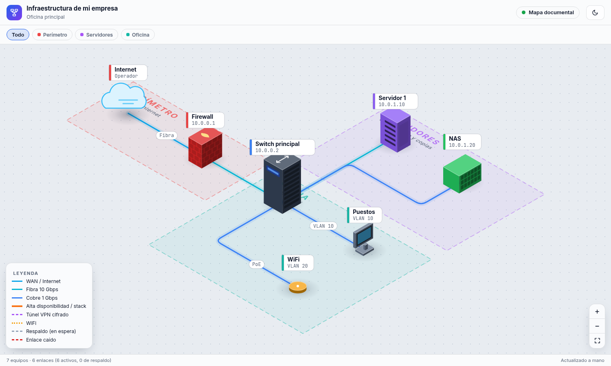

# Mapa de infraestructura

Mapa isométrico de una red en SVG, con luces que viajan por los cables, ficha por equipo, resaltado por zona, zoom y tema claro/oscuro. No necesita servidor ni compilar nada: abre `index.html` con doble clic.



**Es un mapa documental, no un monitor.** Dibuja lo que pongas en `datos.js`; no comprueba si los equipos están encendidos. El estado de cada equipo lo marcas tú.

## Cómo está hecho

| Archivo | Qué hace |
|---|---|
| `datos.js` | Zonas, equipos y enlaces. **Es el único que hay que tocar.** |
| `datos-plantilla.js` | Red pequeña de ejemplo para empezar |
| `app.js` | Motor: proyección, dibujo, cables, zoom, ficha, simulaciones y tour |
| `estilo.css` | Aspecto y temas |
| `vendor/gsap.min.js` | Animaciones (GSAP 3.15, [licencia estándar](https://gsap.com/standard-license)) |

Cada equipo se coloca en un plano (`X`, `Y`) y `iso()` lo proyecta en isométrico. Los cables siguen los ejes del suelo y sus luces son `animateMotion` de SVG. Las fuentes vienen de Google Fonts; sin Internet se usan las del sistema.

## Dibujar tu red

1. Copia la plantilla: `cp datos-plantilla.js datos.js`
2. Cambia los equipos y recarga la página.

Si un enlace apunta a un equipo que no existe o un equipo a una zona que no existe, el mapa muestra el error en lugar de dibujarse.

Con `simulaciones: false` se ocultan las simulaciones y el tour, porque solo funcionan con los equipos de la demo. Para volver a la demo: `git checkout datos.js`.

### Zona

```js
{ id: 'cpd', n: 'Servidores', s: 'subtítulo', x: [5, 11], y: [-3.4, .4], c: '#a855f7' }
```

`x` e `y` son el rectángulo en el plano y `c` el color.

### Equipo

```js
{ id: 'srv', t: 'servidor', X: 6.4, Y: -2.2, n: 'Servidor 1', ip: '10.0.1.10', z: 'cpd', c: '#8b5cf6', tipo: 'Hipervisor', d: 'Descripción de la ficha.' }
```

- `t`, dibujo: `nube` `router` `firewall` `core` `switch` `wlc` `servidor` `almacen` `ap` `pc` `portatil` `movil` `telefono` `impresora` `camara`
- `z`: id de su zona. `c`: color (opcional).
- `e`: estado, `ok` por defecto, `standby` o `caido` (opcional).
- `grande: true`: switch más grande (opcional).

### Enlace

```js
['sw', 'nas', 'cobre', 'activo', { r: 'my', my: -.6, et: 'Etiqueta' }]
```

Orden: origen, destino, tipo de cable, modo y opciones.

- Tipo: `wan` `fibra` `cobre` `ha` `vpn` `wifi` `dmz`
- Modo: `activo` o `standby`
- `r`, ruta del cable: `'m'` codo a mitad de X (fíjalo con `mx`), `'my'` codo a mitad de Y (fíjalo con `my`), `'x'` o `'y'` eje primero, o una lista de puntos `[[x, y], [x, y]]`
- `et`: etiqueta sobre el cable

## Seguridad

Un mapa con IPs y equipos reales describe tu red a quien lo lea. Mantén este repositorio **privado** y no pongas contraseñas ni claves en `datos.js`.
